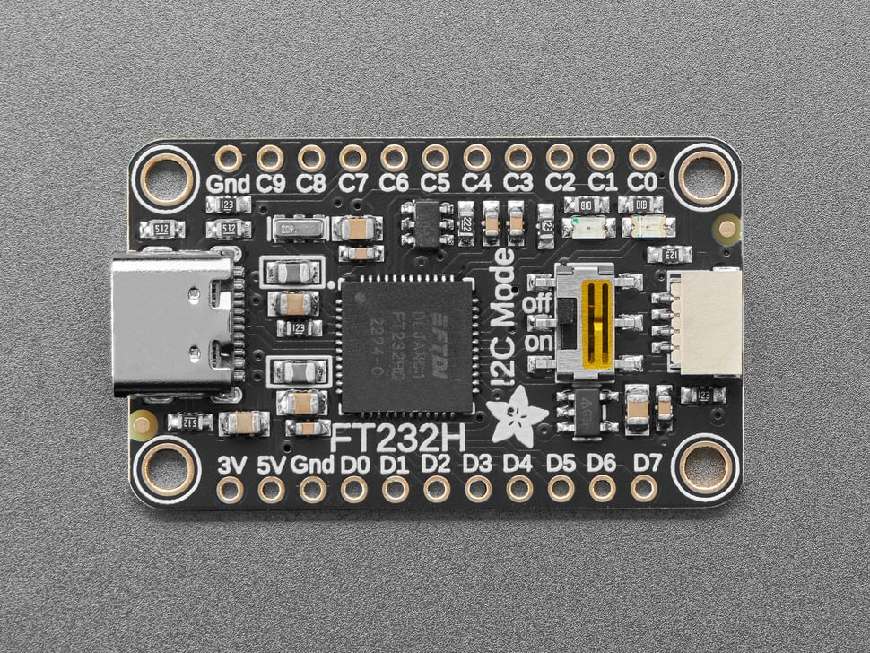
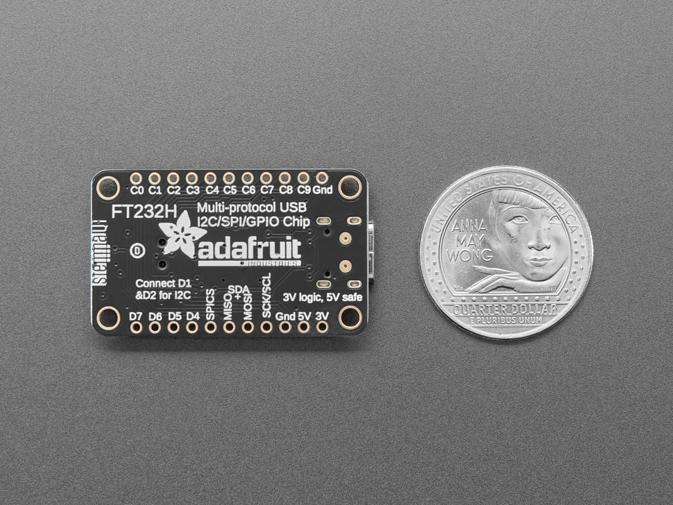

# Propuesta de réplica 

**Réplica de módulo FT232H con conectores SPI e I²C**

El módulo permite comunicar una computadora por USB-C con dispositivos SPI o I²C, como memorias y sensores. También expone pines de entrada y salida digital (GPIO). La referencia es el Adafruit FT232H Breakout, producto 2264, en su revisión USB-C y STEMMA QT. [Ficha del producto](https://www.adafruit.com/product/2264) · [Documentación de Adafruit](https://learn.adafruit.com/adafruit-ft232h-breakout/downloads#schematic-1856556).

## Cambios propuestos

1. Pasar las resistencias R1 a R11 y los capacitores de 100 nF C2, C6, C7, C8 y C9 de 0603 a 0805, conservando sus valores. El mayor tamaño facilita la soldadura y el retrabajo manual.
2. Usar el **FT232HL en LQFP-48** en lugar del FT232HQ en QFN-48. Los terminales visibles facilitan la inspección y el acceso con el soldador.
3. Agregar un conector SPI de seis pines y un conector I²C de cuatro pines, ambos de paso 2,54 mm. Cada conector agrupa las señales de su interfaz, 3,3 V y masa.

| Conector | Señales |
| --- | --- |
| SPI | SCK, MOSI, MISO, CS, 3,3 V y GND |
| I²C | SCL, SDA, 3,3 V y GND |

SPI e I²C comparten pines del FT232H y se usan por turnos. El selector I²C une D1 y D2 para formar SDA. En modo SPI, esos pines se usan por separado como MOSI y MISO. [Distribución de pines de Adafruit](https://learn.adafruit.com/circuitpython-on-any-computer-with-ft232h/pinouts).

## Características previstas

| Parámetro | Propuesta |
| --- | --- |
| Herramienta de diseño | KiCad |
| Capas de cobre | 2 |
| Cara de montaje | Superior |
| Componentes | **36**, incluidos los conectores. Son 34 del módulo original más 2 conectores dedicados. |
| Tamaño de referencia | Aproximadamente 23 × 38 mm para el módulo comercial. El tamaño de la réplica se definirá durante el posicionamiento. |

## Módulo de referencia

| Vista superior | Vista inferior |
| --- | --- |
|  |  |

Fotografías de Adafruit Industries. [Vista superior original](https://cdn-shop.adafruit.com/970x728/2264-16.jpg) · [Vista inferior original](https://cdn-shop.adafruit.com/970x728/2264-10.jpg).

## Esquemático de referencia

Esquemático de Adafruit Industries, revisión D. [Imagen en resolución original](referencia/esquematico-adafruit.png) · [Archivo de diseño de referencia](https://github.com/adafruit/Adafruit-FT232H-Breakout-PCB/blob/78919715d58046e883cc4fe47f90c6634582adf7/Adafruit%20FT232H.sch) · [Créditos del proyecto original](referencia/README-Adafruit.md).
